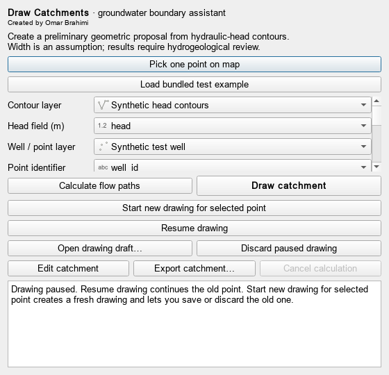
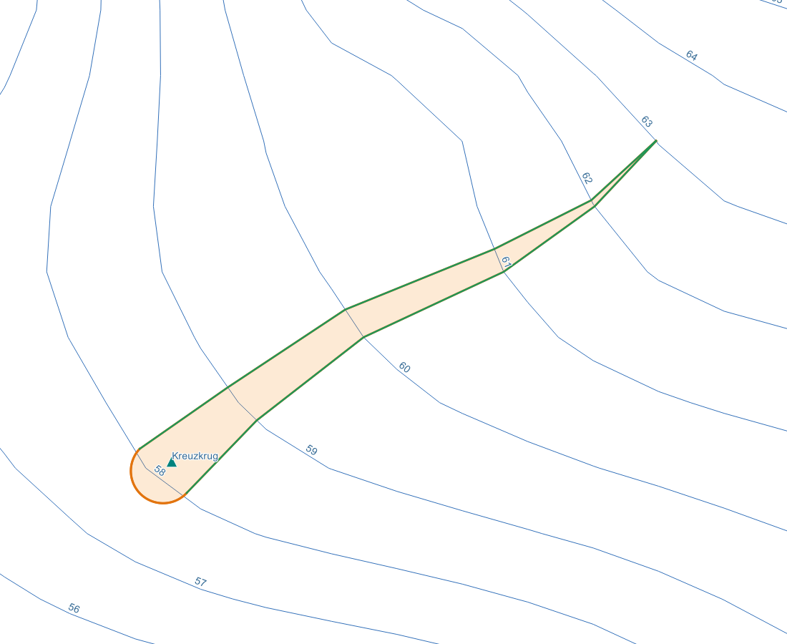

# Draw Catchments

Created by **Omar Brahimi**.

Draw Catchments helps you outline preliminary groundwater catchment polygons
directly in QGIS, using your own groundwater contours and selected wells,
monitoring stations or a location picked on the map.

## Start a catchment

1. Load a groundwater contour **line layer** with hydraulic-head values in metres.
   Optionally load a **point layer** containing wells or monitoring stations.
2. Open Draw Catchments. Choose the contour layer and its water-level field.
   A feature ID is not a hydraulic-head value.
3. Use **Pick one point on map**, choose a point from the list, or select several
   nearby wells to create a shared proposal.
4. Review the **starting width** and **upstream limit**. The automatic width is
   a geometric suggestion that you can replace with a manual width.
5. Click **Draw catchment**. Inspect the polygon, calculated paths and stopping
   reasons on the existing QGIS map. An upstream contour limit is not a verified
   groundwater divide.

## Draw manually

Click **Start new drawing for selected point**. Each contour interval is one
straight segment. An exact 90-degree arrival is preferred. When that is blocked
or impossible, the tool searches for the closest feasible straight candidate
and shows its actual angle. **Exact 90° only** remains an optional mode.
Direction can change at a contour. **Add next contour** accepts the orange preview.
Clicking a farther contour includes intermediate straight steps when a valid
route exists. **Switch side** changes the active boundary and **Undo last step**
removes its latest step. Finish both sides on the same connected contour.

**Rounded arc** affects only the downstream closure around the selected point.
Its depth is adjustable and previewed as a dashed orange line. It does not curve
the lateral segments. The upstream closure follows the selected contour.

Click **Place arc endpoints on map** to choose the two arc endpoints yourself.
They also become the starts of the two uphill sides, and are kept at your exact
map positions. The arc is a geometric half-ellipse: its width comes from these
two points and its adjustable depth defaults to half that width (a semicircle).
Only the closure around the well is rounded. Move starts before drawing, or undo
both sides first; existing work is never silently cleared.

The best-angle fallback still rejects crossings of other contours or boundaries.
Angles in the preview and export are measured from the whole straight segment
against the original contour segment. Corners have no unique tangent, so candidate
endpoints are inset slightly. The candidate search is numerical, not proof of a
global angular optimum. Strongly oblique arrivals require interpretation.

Automatic analysis expands when the paths approach the calculation window edge
and source contours extend beyond it. It keeps the starts fixed and continues
upstream. The closing contour is selected from actual vector intersections,
not rounded interpolated heads. A source-data edge, a flat gradient or the
highest connected contour still does not establish a groundwater divide.
Use **Marked upstream target area** or **Custom boundary layer** for an explicit
upstream destination. A requested boundary must be reached by both paths before
a polygon is returned; inspection paths can be calculated separately.

## Change the point or resume work

Click **Pause / return** in the drawing panel, then select another well or
monitoring station using **Pick one point on map** or the **Point** list.

- **Start new drawing for selected point** starts at the current selection.
  If a drawing is unfinished, choose **Save draft & start new** or
  **Discard & start new**. **Cancel** keeps the existing drawing.
- **Resume drawing** continues the previous drawing with its original point,
  arc endpoints and boundary paths, regardless of the current point selection.

Saved drafts can be reopened with **Open drawing draft**. Failed or cancelled
saves leave the existing drawing intact. Old arc endpoints are not reused for
the new site; deliberately selected new endpoints are retained.

## Save and edit

- **Finish & export** creates and saves a completed manual polygon.
- **Export catchment** saves an automatic result or edited polygon.
- **Save drawing draft** preserves unfinished manual work; open the draft to resume.
- **Edit catchment** lets you adjust the result with normal QGIS editing tools.

Export to **GeoPackage**, **Shapefile** or **GeoJSON**. GeoPackage also preserves
the original polygon, paths, start points and closing boundaries. A JSON sidecar
stores calculation settings. Export temporary layers before closing QGIS.

## Install

In QGIS, open **Plugins > Manage and Install Plugins > Install from ZIP**, select
the supplied plugin ZIP and install it. Restart QGIS after replacing an existing
installation. Open **Draw Catchments** from the Vector menu or its toolbar icon.

## Interpret the result

These polygons are preliminary geometric proposals for hydrogeological review.
Starting width and downstream closure are assumptions, not calculated capture
widths. The tool assumes isotropic head geometry and does not model pumping,
recharge or travel time. Use contours for the appropriate aquifer and conditions.

The plugin uses Python, PyQGIS, NumPy and SciPy in the QGIS environment.
Source code is licensed under GPL-3.0-or-later. Dataset-specific attribution and
executed validation reports are included in the accompanying project documents.

## Project and support

[Source code](https://github.com/Omar-dz98/Draw-Catchments) ·
[Report a problem](https://github.com/Omar-dz98/Draw-Catchments/issues)

This is an experimental plugin. Executed validation uses QGIS 3.36.3 on Windows;
other QGIS versions and operating systems have not yet been verified. The declared
range is QGIS 3.36–3.x. QGIS 4 / Qt 6 compatibility is not claimed.
NumPy and SciPy must be available in the Python environment used by QGIS.
In the QGIS Python console, `import numpy, scipy` checks these dependencies.
Use your QGIS distribution's package manager/environment if either is missing.

The map example uses LfU Brandenburg spring-2015 data under DL-DE BY 2.0.
It is a geometric demonstration around a monitoring station, not an official
catchment or a validated pumping capture zone. See [data attribution](DATA_SOURCES.md).

See [development and tests](CONTRIBUTING.md), [validation](docs/VALIDATION.txt),
[known limitations](docs/KNOWN_LIMITATIONS.txt) and [publishing](docs/PUBLISHING.txt).
